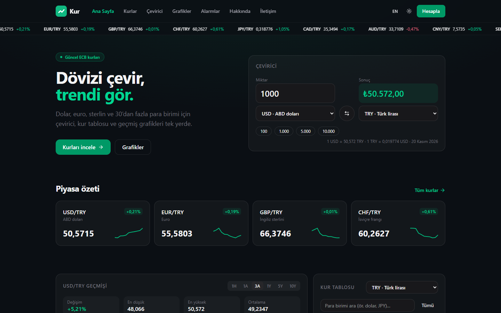
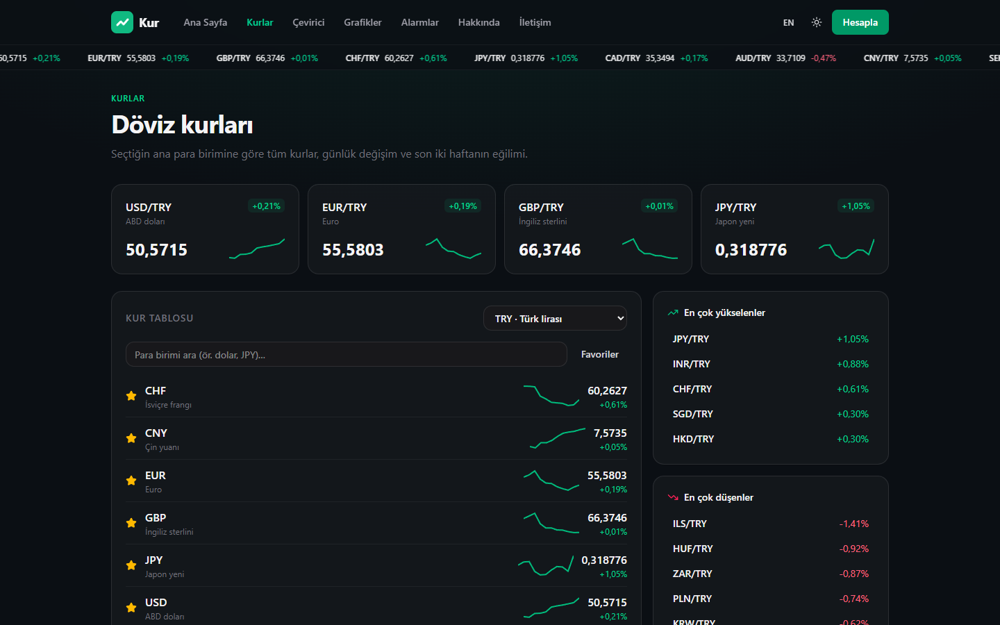
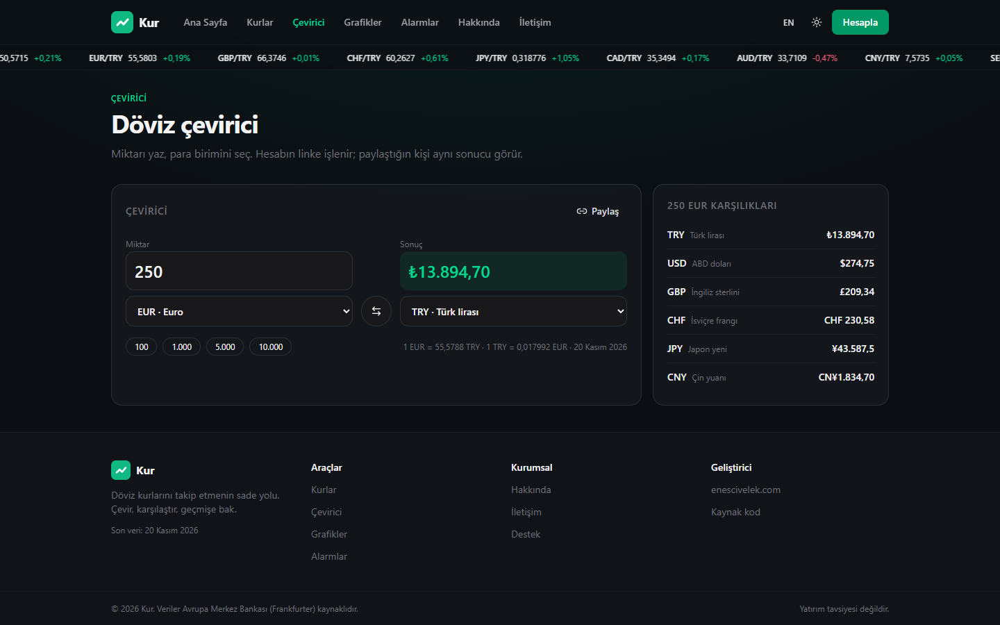
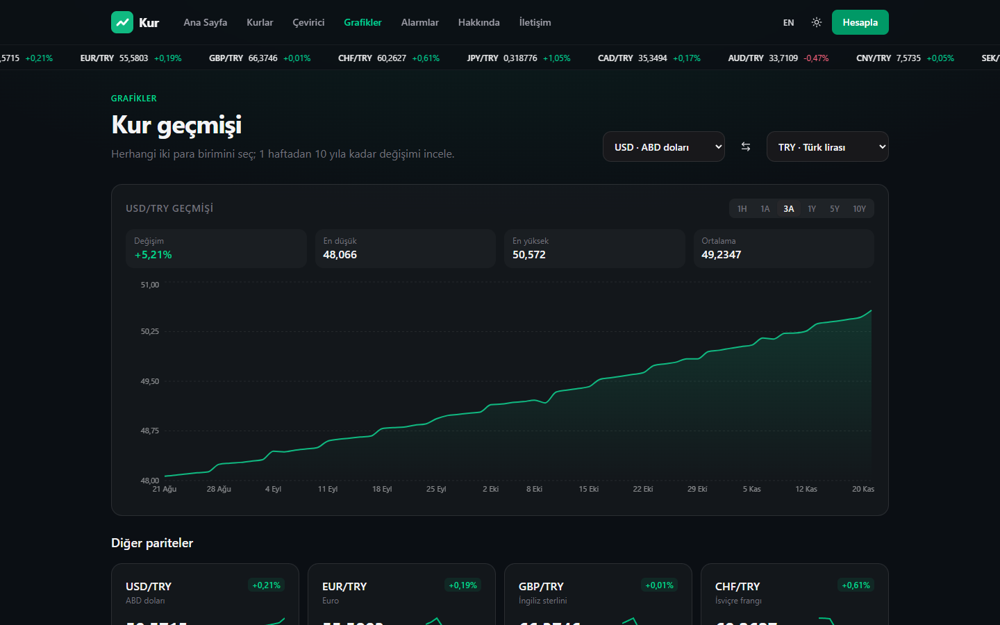
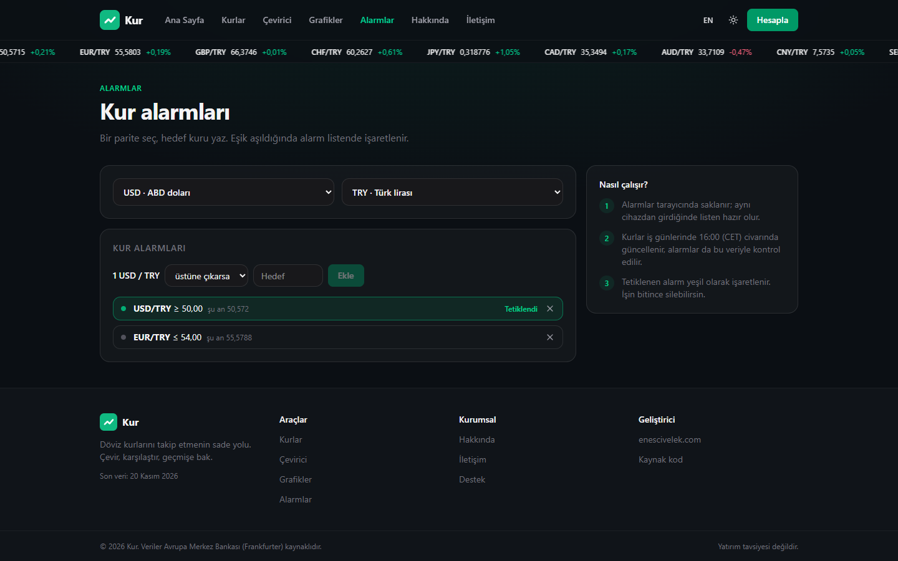
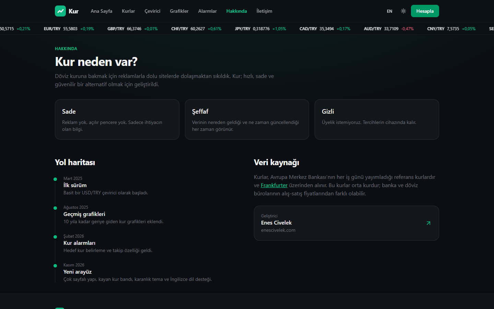
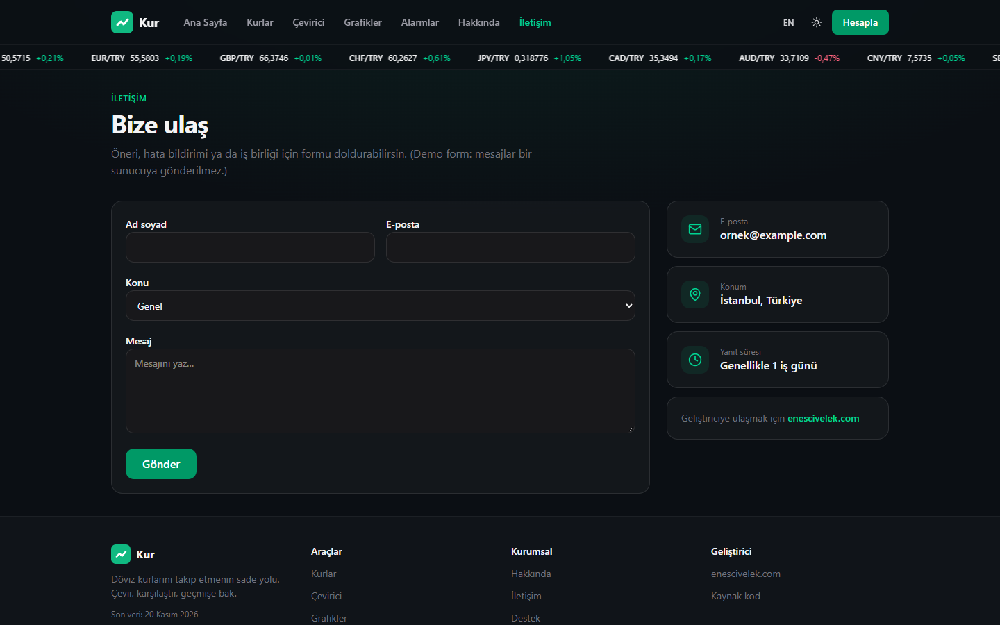
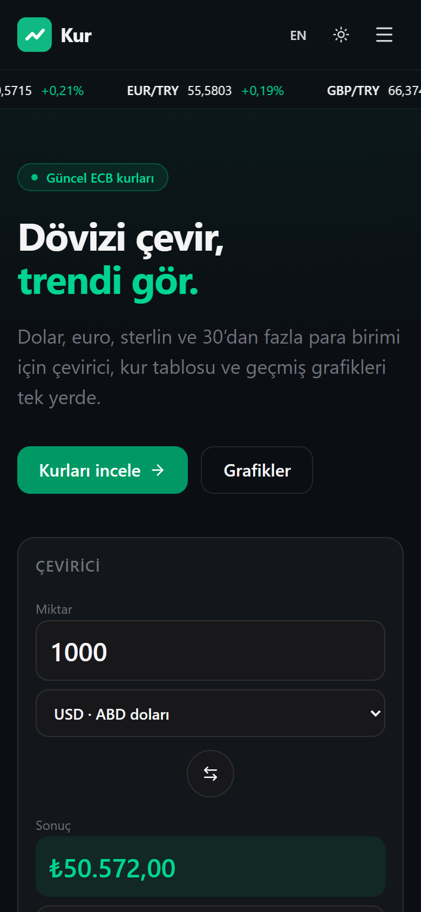
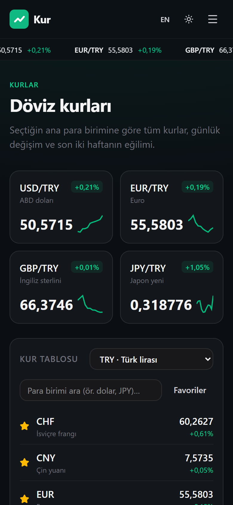

# Kur · Döviz Çevirici & Analiz

Avrupa Merkez Bankası referans kurlarıyla çalışan, çok sayfalı, Türkçe/İngilizce döviz uygulaması.

🔗 **Canlı demo:** [kur-dusky.vercel.app](https://kur-dusky.vercel.app/)



## Özellikler

- **Ana sayfa:** Kayan kur bandı, hızlı çevirici, piyasa özeti, USD/TRY grafiği, SSS
- **Kurlar:** Ana para birimine göre tüm kurlar, günlük % değişim, mini grafikler, arama, favoriler, en çok yükselen/düşenler
- **Çevirici:** 30+ para birimi, favorilere toplu karşılık listesi, URL üzerinden paylaşılabilir hesap (`?amount=250&from=EUR&to=TRY`)
- **Grafikler:** Herhangi iki para birimi, 1 hafta – 10 yıl aralık, değişim / en düşük / en yüksek / ortalama
- **Alarmlar:** Hedef kur belirleme, eşik aşıldığında işaretleme
- **Hakkında / İletişim:** Tanıtım sayfası ve demo iletişim formu
- **TR / EN** dil desteği (sayı ve tarih biçimleri dahil), **karanlık / aydınlık tema**, mobil uyumlu arayüz
- Veritabanı ve API key yok: tercihler `localStorage`'da tutulur

## Ekran görüntüleri

| Kurlar | Çevirici |
|---|---|
|  |  |
| **Grafikler** | **Alarmlar** |
|  |  |
| **Hakkında** | **İletişim** |
|  |  |

<p>
  
  
</p>

## Teknolojiler

| Alan | Kullanılan |
|---|---|
| Arayüz | React 19, TypeScript, Vite |
| Yönlendirme | React Router |
| Stil | Tailwind CSS v4, Lucide ikonları |
| Sunucu durumu | TanStack Query (önbellek, iptal, `keepPreviousData`) |
| İstemci durumu | Zustand + `persist` (tema, dil, favoriler, alarmlar) |
| Grafik | Recharts (lazy-load ile ayrı chunk) |
| Veri | [Frankfurter API](https://frankfurter.dev) (ECB) |
| Yayın | Vercel |

## Proje yapısı

```
src/
├─ pages/        Home, Rates, ConverterPage, Charts, AlertsPage, About, Contact, NotFound
├─ components/   Layout, Ticker, Converter, RatesBoard, HistoryChart, MarketCards, Movers, Alerts…
├─ lib/          api.ts, queries.ts (React Query hook'ları), format.ts, currency.ts, useUrlState.ts
├─ i18n.ts       TR / EN sözlükleri
└─ store.ts      Kalıcı uygulama durumu
```

## Kurulum

```bash
npm install
npm run dev          # http://localhost:5173
npm run build        # üretim derlemesi
npm run screenshots  # README görsellerini yeniden üretir (dev sunucusu açıkken)
```

## Notlar

Kurlar ECB tarafından iş günlerinde ~16:00 CET'te güncellenir; anlık piyasa fiyatı değildir. İletişim formu ve iletişim bilgileri demo amaçlıdır; form hiçbir veri göndermez. Yatırım tavsiyesi değildir.

---

Geliştiren: [Enes Civelek](https://enescivelek.com) · Lisans: [MIT](LICENSE)
